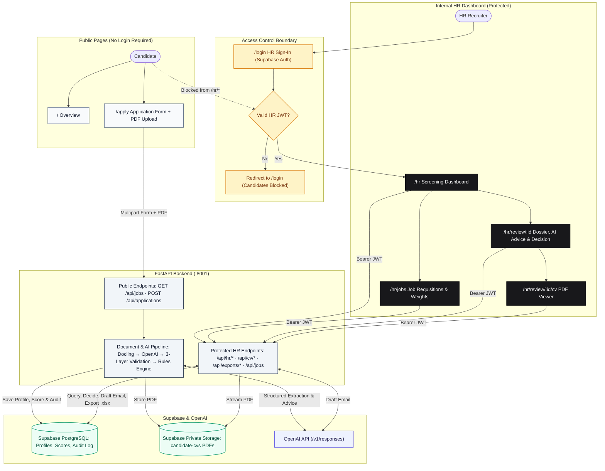

# AI-Assisted HR Recruitment Screening Platform

An AI-assisted recruitment platform that automates repetitive CV processing while keeping hiring decisions strictly with HR.

- **Candidates** apply through a public portal (`/apply`) and upload a PDF CV.
- **The Backend** extracts CV text with Docling, parses structured fields via OpenAI, validates output in 3 layers, and computes a deterministic score.
- **HR Staff** sign in to an internal dashboard (`/hr`) to review profiles, inspect score evidence, draft candidate emails, export Excel reports, and make the final Approve/Reject decision.

> **Core principle:** AI assists with extraction and advisory summaries. Deterministic rules compute all scores, and **only HR** makes consequential decisions.

---

## System Architecture & Access Boundaries

Candidates can only access the public portal (`/` and `/apply`). All internal HR pages (`/hr`, `/hr/jobs`, `/hr/review/:id`) are guarded by Supabase Auth on the frontend (`ProtectedRoute`) and verified via JWT Bearer tokens on the FastAPI backend.



### Page Access Summary

| Route | Audience | Auth Required | Purpose |
|---|---|---|---|
| `/` and `/apply` | Public (Candidates) | No | View overview, browse open roles, submit application & PDF CV |
| `/login` | HR Staff | No | Sign in with Supabase email/password |
| `/hr`, `/hr/jobs`, `/hr/review/:id`, `/hr/review/:id/cv` | HR Staff Only | Yes (JWT) | Screen candidates, manage jobs/weights, approve/reject, export Excel |

---

## Tech Stack

| Layer | Technologies |
|---|---|
| **Frontend** | React 19, TypeScript (strict), Vite, Tailwind CSS v4, shadcn/ui (`Geist Variable`), React Router, `pnpm` |
| **Backend** | Python 3.12+, FastAPI, Pydantic v2, SQLAlchemy 2, Alembic, `uv` |
| **Database & Storage** | Supabase PostgreSQL (source of truth) + Supabase Private Storage (`candidate-cvs` bucket) |
| **Auth** | Supabase Auth (Email/Password JWT verified on backend via `get_user`) |
| **AI & PDF** | Docling (PDF → Markdown), OpenAI SDK via `instructor` (`RESPONSES_TOOLS` mode) |
| **Reporting** | `openpyxl` (`.xlsx` streaming export) |

---

## Step-by-Step Setup

### Prerequisites

- **Python 3.12+** and [`uv`](https://docs.astral.sh/uv/)
- **Node.js 20+** and [`pnpm`](https://pnpm.io/)
- A **Supabase** project (URL, Anon Key, Service Role Key, Direct Postgres URL)
- An **OpenAI API key**

### 1. Configure Environment Variables

Create `backend/.env` from `backend/.env.example`:

```bash
cp backend/.env.example backend/.env
```

Fill in your credentials in `backend/.env`:
- `SUPABASE_URL`, `SUPABASE_ANON_KEY`, `SUPABASE_SERVICE_ROLE_KEY`
- `DATABASE_URL` (use the `postgresql+psycopg://` scheme with your Supabase direct connection string)
- `OPENAI_API_KEY` and `OPENAI_CHAT_MODEL` (e.g. `gpt-6-luna`)
- `ALLOWED_ORIGINS=http://localhost:5174`

Create `frontend/.env` from `frontend/.env.example`:

```bash
cp frontend/.env.example frontend/.env
```

Fill in `frontend/.env`:
- `VITE_API_BASE_URL=http://localhost:8001`
- `VITE_SUPABASE_URL` and `VITE_SUPABASE_ANON_KEY`

### 2. Set Up & Run the Backend

```bash
cd backend
uv sync --locked
uv run --locked --no-sync alembic upgrade head
uv run --locked --no-sync python scripts/setup_storage.py
uv run --locked --no-sync uvicorn app.main:app --reload --port 8001
```

Verify the backend is running at `http://localhost:8001/health`.

### 3. Set Up & Run the Frontend

In a new terminal:

```bash
cd frontend
pnpm install --frozen-lockfile
pnpm dev
```

Open `http://localhost:5174` in your browser.

### 4. Create an HR User

1. Open your **Supabase Dashboard → Authentication → Users → Add user**.
2. Create an email/password account for HR.
3. Visit `http://localhost:5174/login` and sign in to access `/hr` and `/hr/jobs`.

---

## Verification

```bash
# Backend lint
cd backend && uv run --locked --no-sync ruff check app

# Frontend lint, typecheck & production build
cd frontend && pnpm lint && pnpm build
```

---

## Further Documentation

| Document | Contents |
|---|---|
| [`docs/client-brief.md`](docs/client-brief.md) | Business problem, 10 gaps, and expected value |
| [`docs/architecture.md`](docs/architecture.md) | State machine, validation pipeline, and locked technical decisions |
| [`docs/build-along.md`](docs/build-along.md) | Step-by-step slice log with commands and checkpoints |
| [`docs/todos.md`](docs/todos.md) | Build plan and decision log |
